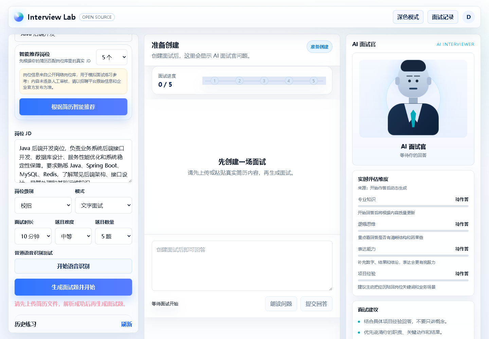

# Interview Lab

**AI 模拟面试与逐题复盘** · A self-hosted interview practice workspace.

从简历与岗位描述开始，完成提问、回答、追问、报告与复盘。支持本地演示，以及可选的 Dify/Coze 与语音服务。

## 快速试用

需要 Node.js 22+：

~~~bash
npm ci
npm run dev
# http://localhost:3000
~~~

默认开启演示模式，无需 API Key。注册本地测试账号，使用 [虚构简历](examples/resume.txt) 和 [岗位示例](examples/job-description.txt) 创建文字面试。

演示采用规则生成的问题和评分，报告明确标记 Mock，不代表真实 AI 评估结果。首次自动创建空数据存储，不附真实简历、面试记录或招聘数据。

## 已实现

- PDF/DOCX/TXT 简历解析、文本编辑、岗位预设和推荐回退。
- 账号认证、历史记录、会话归属检查。
- 多轮问答、追问、题量设置、最终报告和逐题复盘界面。
- 可选语音输入/播报与摄像头本地预览，取决于浏览器和服务配置。
- 提示词输入边界处理、结构化 API 与本地文件持久化。

## 连接真实服务

复制 .env.example 为 .env.local，配置自己的凭据，设置 DEMO_MODE=false 后重启。

| 服务 | 主要配置 |
|---|---|
| Dify 主面试 | DIFY_API_BASE、DIFY_API_KEY |
| Dify 辅助能力 | DIFY_RESUME_API_KEY、DIFY_REVIEW_API_KEY、DIFY_JOB_RECOMMEND_API_KEY |
| Coze 工作流 | COZE_API_BASE、COZE_API_TOKEN 与工作流 ID |
| 讯飞语音 | XF_*、SPARK_*，见环境模板 |

接入约定见 [服务说明](docs/PROVIDERS.md)。演示模式屏蔽外部招聘刷新，不附招聘平台登录状态。

## 验证

~~~bash
npm run typecheck
npm run build
npm start
# 另开终端
npm run test:smoke
~~~

烟雾检查覆盖注册、会话隔离、完整问答和报告，会创建虚构测试账号与记录。可用 SMOKE_BASE_URL 指定本地测试地址，见 [验证记录](docs/VALIDATION.md)。

Next.js 15 + React 19 + TypeScript · app 页面/API · components/interview 面试组件 · lib 服务、认证与存储。

本地 JSON/SQLite 适合单实例演示，多实例需替换为共享数据库。摄像头预览不等于服务端视频理解，当前不根据外貌、情绪或人格做招聘判断；报告仅用于练习。

[MIT](LICENSE) · [贡献指南](CONTRIBUTING.md)
